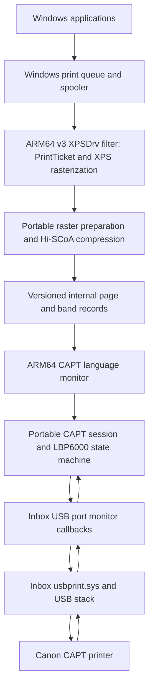

# Architecture

The 0.3 Windows queue candidate uses the existing Microsoft PDF renderer,
the Standard TCP/IP port monitor, and a local CAPT print service. See
[current queue design](docs/WINDOWS_QUEUE.md). The XPSDrv and custom monitor
design below is the earlier architecture proposal.

Status: proposed Windows integration; portable framing, raster/codec and experimental session implemented.
The separate Windows ARM64 diagnostic has user-reported GUI/worker, enumeration,
exclusive-open and identity-I/O evidence. Version 0.1.1 completed a live CAPT status exchange. It is outside the spooler architecture.
The reasoning and primary-source references are in [FEASIBILITY.md](FEASIBILITY.md).

## Preferred direct USB prototype

All new executable components are user mode and native ARM64. The only kernel
code in this path is supplied by Windows. A user-mode print driver is not a
UMDF device driver: UMDF is not required merely because we prefer user mode.

The renderer cannot precompute a complete static USB conversation: actual job
numbers and status replies affect what is sent next. Therefore it emits bounded
page/band records into the spool stream; the monitor interprets these and owns
live protocol exchanges. This internal record format is **not implemented or
specified yet** and must never be sent directly to the printer. Give it a version,
explicit little-endian fields, record sizes, page parameters, compressed-band
lengths, limits and malformed-stream rejection before wiring it into a monitor.
`WritePort` boundaries are arbitrary and must not become record boundaries.

## Component contracts

| Component | Responsibility | Current status |
| --- | --- | --- |
| Protocol (`include/capt/protocol.hpp`, `src/protocol.cpp`) | Ordinary frame serialization and bounded reply reading with explicit length encoding | Implemented and unit tested on Linux |
| Raster (`include/capt/raster.hpp`, `src/raster.cpp`) | Grayscale packing, source stride, explicit crop/placement and bounded page bands | Implemented and unit tested on Linux; physical geometry unverified |
| Hi-SCoA codec (`include/capt/hiscoa.hpp`, `src/hiscoa.cpp`) | Bounded compression, parameter encoding, bit fixtures and reference comparison | Implemented; 1,042 bands verified on Linux; no printer validation |
| Model/session (`include/capt/session.hpp`, `src/session.cpp`) | Reference-derived LBP6000 setup, reply policy, job/page states, flow control, deadlines and cancellation | Implemented against synthetic scripts; hardware sequence unverified |
| Status (`include/capt/status.hpp`, `src/status.cpp`) | Checked extended-status decoding with optional tail fields | Implemented; all truncated/optional boundaries tested |
| Identity (`include/capt/device_id.hpp`) | Bounded IEEE 1284 decoding and diagnostic model allow-list | Linux tests include captured 04A9:271A reply and an explicit device-scoped quirk |
| Windows diagnostic (`windows/`) | GUI, process supervision, SetupAPI discovery, USBPRINT identity and CAPT status I/O | 0.1.1 identified the printer and received a 92-byte CAPT status reply on the Surface |
| Transport/control (`include/capt/control.hpp`) | Context-aware reads/writes, monotonic time and cancellation; later USBPRINT or WinUSB adapter | Interfaces and test implementations only; diagnostic I/O does not satisfy the production session contract |
| Windows rendering | XPSDrv filter, PrintTicket/capabilities, WIC/grayscale/halftone conversion | Proposed; ARM64 smoke test required |
| Windows monitor | `MONITOR2` callbacks, internal-stream parser, serialized device session, spooler job mapping | Proposed; no DLL exists |
| Installation | Hardware ID matching, signed ARM64 package, queue setup, GUI errors/uninstall | Planned; no INF or catalog exists |

The diagnostic uses direct `CreateFileW`/overlapped I/O in an isolated worker.
Its cancellation completion drain can block, so a GUI-owned job object supplies
a process-level watchdog. It implements primitive `Transport`, not
`SessionTransport`; it cannot be used inside the spooler as a proven bounded
adapter. The actual `ReadPort`/`WritePort` path remains an independent gate.
See [diagnostic contracts](docs/WINDOWS_PROBE.md).

The core uses only standard C++17 types and byte-wise integer encoding.
No native structs are written to wire, no global job state is shared, and no
CUPS/Windows header is included. The audited codec is a C++ adaptation of the
reference C implementation. C++ exceptions must be translated at future Windows callback
boundaries and must never escape through a C/COM ABI.

### Initial protocol/transport boundary

`Transport::read_some` and `write_some` return a positive count no larger than
the requested byte count, or throw on timeout/disconnect/cancellation/error.
Zero progress is an error. The implementation loops over partial progress.
A future USB adapter must retain any extra bytes internally and honor requested
byte counts; a byte-stream mock does not prove USB transfer/pipeline semantics.
Each real adapter needs finite operation timeouts, and a future session must
also impose an overall transaction deadline and cooperative cancellation.
These primitive helpers have no wall-clock deadline and cannot interrupt a
blocking adapter; their tests use finite in-memory mocks.

The session uses the separate `SessionTransport` contract with `IoContext` on
every read/write, an injected `Runtime` and atomic cancellation tokens. Whole
operation and transaction deadlines span polls and partial I/O. A checked
adapter feeds the original framing helpers. Real adapters must enforce the
context inside blocking calls; the core cannot preempt a stuck OS call. No
automatic conversion from the old `Transport` is provided. See
[session contracts](docs/SESSION.md) for timing and framing recovery rules.

`read_reply` reads six bytes initially, validates the echoed command and the
declared total length, enforces a caller limit, then reads exactly the remaining
bytes. Binary is default; BCD requires explicit caller selection and valid
decimal nibbles. There is no heuristic fallback that might overread a subsequent
message. Whether LBP6000 needs BCD for any particular command is unverified.
The `0xA1A0` raw identification reply needs a separate reader, not this helper.
`write_packet` caps requested writes at 4096 bytes as a reference-derived starting
point; that is not a measured Windows optimum. Helpers do not decide which
commands expect a reply, lock sessions, retry, or recover a desynchronized device.

### Raster contract

The row primitive packs 8-bit grayscale (`0` black, `255` white),
using `sample < threshold` for black. Bits run MSB first; `1` means black and
unused low bits in the last byte remain zero. This is a core representation
consistent with the reference's zero-filled white padding; physical output
polarity and geometry still need validation. Thresholding is a testable baseline,
not the final photo-quality halftoner.

`prepare_monochrome_band` adds explicit source stride, checked buffer extents,
source cropping, pixel placement/margins, output byte stride and band sizing.
It processes only one band, leaving the final band short and unused pixels
white. `hiscoa::compress_band` accepts those packed rows, checks dimensions and
output limits, and returns a complete aligned/XORed band. Both cap input or
allocated raster bands at 16 MiB as a resource policy; compressed output can
reach approximately 24 MiB at that input limit. DPI, physical margins, media,
BGRA/alpha processing and resampling are not inferred.

The codec preserves the reference's prefix and padding behavior, including an
extra all-ones word when END is already word aligned. End-of-page marker policy
belongs in the future model/session layer: the reference printing helper uses
normal band markers plus CAPT page-end commands. See [codec audit](docs/HISCOA.md).

## Job and device ownership

One session owns each physical device. Serialize status polling, writes and
reads together. A command requiring a reply must finish its read before the
next command; a one-way command must not trigger a read. Status logging must
not create a second independent device client.

The implemented session serializes operations, validates state transitions and
faults a job after an operation failure. It decodes status lengths before field
access, requires decoding-counter progress before firing a new page and waits
for target out/completed counters. It supports bounded explicit cleanup when
framing and a known job number remain available. Partial/malformed transactions
require transport/device recovery. Cancellation after firing never replays the
page. Test clocks make these paths deterministic without hardware.

The current policy retains one compressed band and no page retry cache. Future
Windows spool storage must not duplicate the entire job in RAM. Callbacks
must preserve last-error semantics, acknowledge accepted input accurately and
map failures to queue status. Job completion must reflect printer completion,
not merely successful host writes. Crash recovery, removal and spooler restart
must release ownership and avoid blindly resending a partly printed job.

Language monitors run in a sensitive spooler context; rendering isolation does
not isolate a custom monitor. Keep its parser small and bounded. A service
split can be considered after the transport proof, but introduces explicit IPC,
ownership, recovery and deployment work. It must not be used to hide unchecked
blocking calls or claim automatic GPL separation.

## Alternative paths

An IPP bridge would use this path:

The shared queue must advertise and actually accept formats Windows sends and
convert them server-side. A raw CAPT queue is insufficient. Validate discovery,
capabilities and IPP job status from the Surface. The reference's network recipe
is not a proof of Windows class-driver or protected-print compatibility.

A local ARM64 IPP service would replace the Linux box with native rendering,
CAPT and USB adapters. A PSA virtual-printer experiment is another integration
option; neither alternative changes the portable core's hardware obligations.
