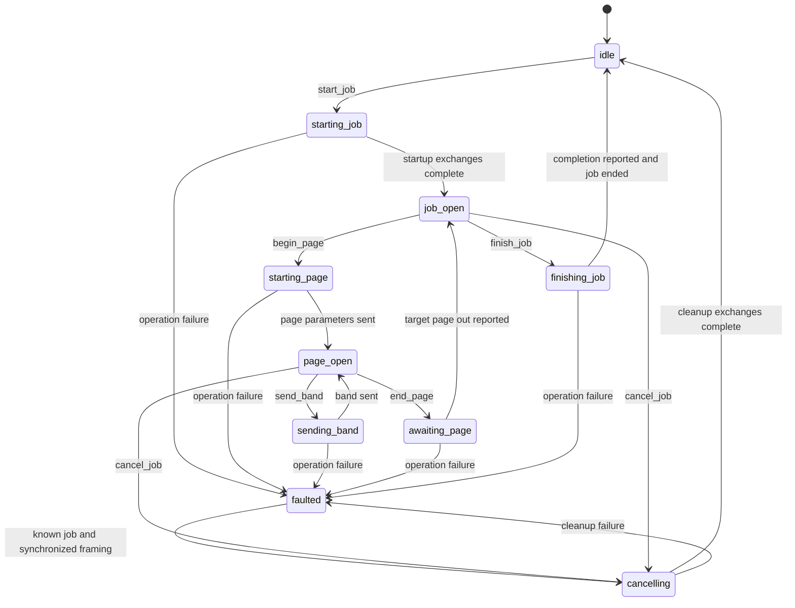

# Portable CAPT session milestone

Implemented on 2026-11-16. The new library code handles a reference-derived
LBP6000 job conversation, with an explicit state machine, checked status data,
finite deadlines and cancellation. Tests use byte scripts and a fake monotonic
clock. No Windows, USB or physical-printer result is established by this work.

## Scope and provenance

`include/capt/session.hpp` and `src/session.cpp` implement the startup and
job/page sequences from `captdriver/src/prn_lbp2900.c`, including the LBP6000
`0xE0BA` setup. Original model-source attribution is retained. Status field and
flag layouts come from `SPECS` and `src/capt-status.*`; framing and compression
use the previously tested portable modules. See [NOTICE.md](../NOTICE.md).

The model profile currently serializes **plain-paper, reference-style 600dpi
settings with A4 or Letter media codes**. The caller supplies imageable and
raster dimensions in pixels, packed row size including padding in bytes, and
the reference CUPS margin fields in integer points. The PDF prototype obtains
its constants from offline reference CUPS raster headers. Density and
toner-save fields follow the reference.
Other media/fuser modes, manual duplex, metadata strings and raw `0xA1A0`
identification are not implemented. Job timestamp input uses normal calendar
values; the wire packet retains the reference's years-since-1900 and zero-based
month convention. The two unexplained metadata constants remain opaque.

## Status decoding

`decode_extended_status` takes only the payload, excluding the four-byte CAPT
header. It requires at least 40 bytes before accessing any mandatory fields.
It constructs a fresh value on every call rather than retaining stale global
fields from a previous status response.

| Field | Payload byte offsets |
| --- | --- |
| Seven raw status words | 0, 8, 10, 12, 24, 30, 38 |
| Page decoding / printing / out / completed | 14 / 16 / 18 / 20 |
| Current job / received pages | 28 / 34 |
| Optional pages in job / pages printed / event counter | 40 / 44 / 64 |

Optional fields are exposed only when their entire word is present. Unknown
extension bytes are ignored. Flags expose busy, buffer-full, initialization,
paper-out and processing/printing bits. Other raw bits remain uninterpreted;
ambiguous reference `nERROR`/button semantics are not turned into invented
printer error codes. Current job ID is decoded but not used as an ownership
proof, because its lifecycle has not been verified on the actual printer.

## State and call sequence

Each session assumes exclusive ownership of its transport. An atomic operation
guard rejects concurrent/reentrant calls, so command/reply exchanges cannot
interleave within one instance. It does not arbitrate another session object
or a separate process opening the same device; the eventual adapter must own
that resource. Public state inspection is atomic. There is no background status
reader racing a print operation, and destruction performs no device I/O.

Argument/state validation and cancellation before an operation starts leave the
prior state intact and send nothing. Once an operation starts, any exception
faults the job. A faulted session cannot begin/replay a page or resend a band.
Only explicitly bounded cleanup is permitted when a known job and complete
message framing remain available. A fresh session after lost framing still
requires actual transport/device recovery; merely constructing an object does
not reset printer state.

## Command and reply policy

The allow-list specifies request lengths and whether a reply must be drained.
Unknown commands are rejected. No automatic binary/BCD fallback is used;
`SessionOptions::reply_quirks` permits validated per-command overrides only.
No BCD quirk is presumed to apply to an LBP6000 by default.

| Commands | Request payload bytes | Reply handling |
| --- | --- | --- |
| `A0A8` extended status | 0 | Echoed frame, at least 40 payload bytes |
| `A1A1`, `A3A2`, `E0A2`, `E0A3`, `E0A4` | 0 | Echoed frame, at least 2 payload bytes |
| `A2A0` job begin | 8 | At least 4 payload bytes; job number read at offset 2 |
| `E0BA`, `E0A7`, `E0A9` | 2 | Echoed frame, at least 2 payload bytes |
| `E0A5`, `E1A2` | 16 | Echoed frame, at least 2 payload bytes |
| `E1A1` job setup | 72 | Echoed frame, at least 2 payload bytes |
| `C0A0` raster data | 1..`FF00` | No reply read |
| `C0A4`, `D0A1`, `D0A2` | 0 | No reply read |
| `D0A0` / `D0A4` | 40 / 8 | Nested setup records, no reply read |
| `D0A9` combined setup | 64 | No reply read |

Ordinary replies must echo the command and fit the configured total-size cap
(default 4096 bytes). A reply is fully consumed before any next command. The
minimum length checks fix the reference's unchecked status and job-number
accesses. Opaque ACK payloads are not assigned undocumented success/error
semantics: a structurally valid ACK is not hardware compatibility evidence.

## Page progress and flow control

Startup performs identification, initial extended-status polling, start/job
begin, LBP3010-style GPIO initialization, readiness checks, LBP6000 setup and
job setup. Page setup performs the reference initialization/upload sequence
when the status flags request it, then sends nested page/compression parameters.

Before setup, the session records the current decoding counter. A page is not
treated as received until received equals decoding **and decoding has changed
from that baseline**. The newly observed value becomes the firing target; it
need not be assumed to increment by one. This prevents stale equal counters
from acknowledging new data and permits a tested `FFFF` to `0000` transition.
The meaning and reset behavior of those counters still need hardware captures.

Bands must arrive in order, match the configured byte stride and provide all
rows exactly once. The session compresses one band with normal band termination
and sends `C0A0` payloads of at most `FF00` bytes. It uses `C0A4` to end the page.
`end_page` refuses to run before every declared row was accepted. It then follows
job-setup flags 2, FIRE, flags 6 and target page-out polling. `finish_job` waits
for the target completed counter, sends flags 4 and closes the known job.
Host write completion alone never completes a page or job in this model.

Busy readiness and raster writability are different checks. Buffer-full blocks
new raster bytes but must not block the control commands that release a received
page. A paper-out condition while processing/printing continues to be polled
within the deadline; when progress has stopped without satisfying the wait,
`PaperOut` is raised. No page is automatically reprinted.

The session retains one compressed band, a job number, page parameters and
counters. It has no full-page retry cache. On uncertain delivery, it faults
instead of replaying. Cleanup cannot retract a page already fired or printed.

## Deadlines, cancellation and adapter obligations

`Runtime` supplies monotonic time and a cancellation-aware wait. `Cancellation`
is an atomic, one-way token; a new job may use a new token. The core does not
hide a system sleep or a USB operation behind the test clock.

| Option | Default |
| --- | --- |
| Whole public operation budget | 120 seconds |
| Transaction budget, including all partial writes and reply reads | 15 seconds |
| Explicit cleanup budget | 5 seconds |
| Poll interval / startup delay | 1 second / 1 second |

Polls share the operation's original deadline. Every transaction receives the
earlier of that deadline and its own transaction limit. Partial progress does
not restart a timeout. Cancellation and expiry are checked before/after I/O,
around waits and around compression. Compression is bounded by the band memory
policy and checked before/after; it does not yet poll cancellation per token.
Durations are validated and clock addition checks overflow. Tests advance
logical time, without wall-clock sleeps.

The new `SessionTransport` deliberately requires an `IoContext` on **every**
read/write. A real adapter must enforce its deadline and cancellation **inside**
blocking I/O. The old primitive `Transport` has no automatic session adapter,
because it cannot provide that guarantee. A late return is detected, but the
portable core cannot preempt a broken adapter or safely kill a blocked thread.
The Windows integration gate must prove this contract for the chosen USB path;
passing `ReadPort` callbacks through unchanged is not sufficient evidence.

When interruption or malformed framing leaves a transaction incomplete, the
session refuses subsequent cleanup commands on that byte stream. If framing
is complete and the printer job number is known, `cancel_job()` can explicitly
run the reference status/GPIO/flags-4/job-end cleanup under its separate budget.
It uses a fresh internal token so an already-requested print cancellation does
not prevent cleanup. Failures remain visible and never trigger a blind retry.

## Deliberate differences and open gates

The port adds strict state/geometry/length checks, stale-counter protection,
deadlines and cancellation. It polls extended status before **every** raster
chunk instead of the reference's every-sixteenth-chunk generic `E0A0` check.
Other LBP6000 control polling also uses `A0A8`. This avoids copying the generic
helper's inconsistent model dispatch, but changes traffic/timing and needs
real-device validation. Readiness also rejects buffer-full for new raster data.

The synthetic tests verify the implemented reference-derived sequence, not a
captured, known-good LBP6000 session. GPIO behavior, metadata constants, ACK
semantics, actual geometry, initialization timing, status quirks, physical
completion and cleanup after real faults remain hardware validation items.
There is no OS time provider, USB implementation, Windows monitor, spooler
error mapping, installable driver or claim of successful printing yet.
